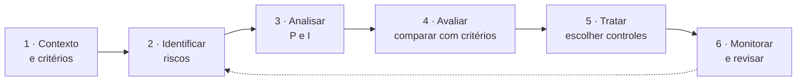

# 🧭 Atividade: Identificação, Classificação e Tratamento de Riscos

### Cenário: Laboratório Maré Viva Análises Clínicas (fictício)

> **Disciplina:** Segurança de Sistemas · **Professor:** Claudio Nunes
> **Formato:** em grupo, de **2 a 4 integrantes**
> **Entrega:** pelo **Microsoft Teams**, na aba **Tarefas** da equipe da disciplina
> ([veja como entregar](#-como-entregar-no-microsoft-teams))
> **Prazo:** o que estiver indicado na tarefa publicada no Teams
> **Esforço estimado:** de 6 a 8 horas de trabalho por grupo

---

## 📋 Sumário

1. [O que você vai fazer](#-o-que-você-vai-fazer)
2. [Objetivos de aprendizagem](#-objetivos-de-aprendizagem)
3. [O que entregar](#-o-que-entregar)
4. [Parte A: revisão de conceitos](#-parte-a-revisão-de-conceitos)
5. [Parte B: o cenário](#-parte-b-o-cenário)
6. [Parte C: passo a passo](#%EF%B8%8F-parte-c-passo-a-passo)
7. [Dicas e erros comuns](#-dicas-e-erros-comuns)
8. [Onde pesquisar](#-onde-pesquisar)
9. [Como entregar no Microsoft Teams](#-como-entregar-no-microsoft-teams)
10. [Perguntas frequentes](#-perguntas-frequentes)
11. [Estrutura do repositório](#-estrutura-deste-repositório)

---

## 🎯 O que você vai fazer

Seu grupo foi contratado como **consultoria de segurança da informação** por um laboratório de
análises clínicas da Baixada Santista. O laboratório nunca fez uma gestão de riscos formal e
acabou de passar por uma série de sustos: um golpe com boleto falso, uma queda de energia que
atrasou exames de urgência e uma paciente que conseguiu ver o exame de outra pessoa pelo portal.

A diretora quer saber **quais são os riscos, quais são os mais graves e onde investir** um
orçamento limitado. Vocês vão:

1. **Ler** o cenário e as evidências coletadas (entrevistas, relatório técnico, ocorrências).
2. **Identificar** os ativos e os riscos de segurança.
3. **Classificar** cada risco com os critérios de probabilidade e impacto do laboratório.
4. **Propor o tratamento** de cada risco, dentro do orçamento, e estimar o risco que sobra.

Não há nada para instalar nem nenhum sistema para testar: é um trabalho de **análise**, feito
numa única planilha, como numa consultoria real.

---

## 🧩 Objetivos de aprendizagem

Ao final, você deve ser capaz de:

- Distinguir **ativo, ameaça, vulnerabilidade, risco e controle** em uma situação concreta.
- Escrever riscos de forma **específica e verificável**, ligados a evidências.
- Aplicar **critérios de probabilidade e impacto** e uma **matriz de risco** de forma justificada.
- Escolher entre **mitigar, evitar, transferir e aceitar** um risco, e defender a escolha.
- Associar controles a **catálogos de controles reconhecidos**, apresentados na
  [seção A.8](#a8-catálogos-de-controles-cis-controls-e-isoiec-27002).
- Pesquisar **vulnerabilidades públicas** (falhas de software já divulgadas) em bases oficiais.
- Relacionar riscos de segurança às obrigações da **Lei Geral de Proteção de Dados Pessoais**.

---

## 📦 O que entregar

**Um único arquivo:** a [planilha-modelo](modelos/registro-de-riscos-mare-viva.xlsx) preenchida.

| Arquivo | Conteúdo | Formato |
|---|---|---|
| `Riscos_MareViva_<Sobrenomes>.xlsx` | Identificação do grupo, premissas, declaração de uso de inteligência artificial, ativos, registro de riscos e pesquisa de vulnerabilidades (o resumo é calculado automaticamente) | **.xlsx** (não converta para PDF) |

Exemplo de nome: `Riscos_MareViva_Silva-Souza-Oliveira.xlsx`.

> [!IMPORTANT]
> Todo o trabalho fica na planilha. Antes de entregar, confira a seção **"Conferência dos
> requisitos"**, no fim da aba `4 Resumo`: ela mostra ✓ ou ⚠ para cada exigência do roteiro.

---

## 📚 Parte A: revisão de conceitos

Leia esta parte antes de abrir o cenário. Ela retoma o que vimos em aula e define **todos os
termos e siglas** que a atividade usa.

### A.1 As peças do risco

Três termos aparecem muito daqui em diante:

- **Backup:** cópia de segurança dos dados, para recuperá-los se o original for perdido ou danificado.
- **Criptografia (cifrar):** embaralhar os dados com uma chave, de forma que só quem tem a chave
  consiga lê-los.
- **Segundo fator** (ou autenticação multifator, MFA): além da senha, o sistema pede uma segunda
  prova de identidade, como um código enviado ao celular. Se a senha vazar, o invasor ainda trava
  no segundo fator.

| Conceito | Definição | Exemplo (fora do cenário, numa escola de idiomas) |
|---|---|---|
| **Ativo** | Qualquer coisa que tenha valor para a organização e precise ser protegida: informação, sistema, equipamento, serviço, pessoa, instalação | O cadastro de alunos; o sistema de matrículas |
| **Ameaça** | Algo ou alguém que **pode causar dano** a um ativo. Pode ser intencional (um criminoso), acidental (um erro humano) ou ambiental (uma enchente) | Um golpista; um funcionário distraído; uma tempestade |
| **Vulnerabilidade** | Uma **fraqueza** que a ameaça pode aproveitar. Está no ativo ou na forma de usá-lo | Senha fraca; sistema sem atualização; servidor no subsolo |
| **Risco** | A **possibilidade** de uma ameaça aproveitar uma vulnerabilidade e causar um **impacto** no negócio | Um golpista adivinhar a senha fraca e copiar o cadastro de alunos |
| **Controle** | Medida que **reduz** o risco: diminui a chance de acontecer ou o tamanho do dano | Exigir senha forte e segundo fator; fazer backup |
| **Incidente** | Um risco que **se concretizou** | O cadastro realmente foi copiado e publicado |

> 💡 **Teste rápido:** a ameaça é o **"quem/o quê"**, a vulnerabilidade é o **"por onde"**, o
> impacto é o **"e daí?"**. Se você não consegue responder às três perguntas, ainda não tem um
> risco: tem só uma preocupação vaga.

### A.2 A tríade C-I-D

Todo risco de segurança afeta pelo menos uma destas três propriedades da informação:

| Letra | Propriedade | Pergunta-chave | Quebra típica |
|:-:|---|---|---|
| **C** | **Confidencialidade** | Só quem tem permissão **vê** a informação? | Vazamento, acesso indevido |
| **I** | **Integridade** | A informação está **correta e completa**? | Alteração indevida, dado corrompido, fraude |
| **D** | **Disponibilidade** | A informação ou o sistema está **acessível quando necessário**? | Sistema fora do ar, dados cifrados por criminosos |

### A.3 O processo de gestão de riscos

Vamos seguir o processo descrito nas normas **ABNT NBR ISO/IEC 27005** (gestão de riscos de
segurança da informação) e **ABNT NBR ISO 31000** (gestão de riscos em geral). ISO é a
*International Organization for Standardization* e IEC, a *International Electrotechnical
Commission*: organizações que publicam normas técnicas internacionais. A ABNT (Associação
Brasileira de Normas Técnicas) publica as versões brasileiras.



| Etapa | O que se faz | Onde aparece nesta atividade |
|---|---|---|
| **1. Contexto e critérios** | Entender o negócio, os ativos e definir como medir probabilidade, impacto e o que é aceitável | Cenário (já fornecido) e [Passo 2](#passo-2--inventário-de-ativos) |
| **2. Identificar** | Encontrar e descrever os riscos | [Passo 3](#passo-3--identificação-dos-riscos) |
| **3. Analisar** | Atribuir probabilidade e impacto e calcular o nível | [Passos 4 e 6](#passo-4--análise-probabilidade-e-impacto) |
| **4. Avaliar** | Comparar o nível com os critérios de aceitação e priorizar | [Passo 5](#passo-5--avaliação-e-priorização) |
| **5. Tratar** | Decidir o que fazer com cada risco | [Passo 7](#passo-7--tratamento-e-orçamento) |
| **6. Monitorar** | Acompanhar se o risco está mudando e se os controles funcionam | [Passo 8](#passo-8--risco-residual-e-monitoramento) |

### A.4 Probabilidade, impacto e matriz de risco

- **Probabilidade (P):** a chance de o risco acontecer num período (aqui, nos próximos 12 meses).
- **Impacto (I):** o tamanho do dano se acontecer (parada, dinheiro, dados, saúde, reputação).
- **Nível de risco = P × I.** Com escalas de 1 a 3, os níveis possíveis são 1, 2, 3, 4, 6 e 9.
- **Matriz de risco (ou mapa de calor):** tabela que cruza P e I e pinta cada célula com a cor da
  classificação. Ela mostra, de uma vez, onde estão os riscos mais graves.

> ⚠️ **P e I não são "achismo".** Cada nota tem que seguir os **critérios da organização**
> (os do laboratório estão no [cenário, seção 4](cenario/laboratorio-mare-viva.md#4-critérios-de-risco-do-laboratório-maré-viva))
> e citar a **evidência** que a sustenta. É isso que torna a análise auditável.

### A.5 Critérios de aceitação e apetite a risco

**Apetite a risco** é quanto risco a organização está disposta a correr para atingir seus
objetivos. Ele vira **critérios de aceitação**: regras que dizem, para cada classificação
(baixo, médio, alto), se o risco pode ser aceito, quem pode aceitá-lo e em quanto tempo deve
ser tratado.

### A.6 As quatro opções de tratamento

| Opção | O que significa | Exemplo (escola de idiomas) | Nome na ISO/IEC 27005 |
|---|---|---|---|
| **Mitigar** | Aplicar controles que reduzem a probabilidade e/ou o impacto | Exigir segundo fator no sistema de matrículas | Modificar o risco |
| **Evitar** | Eliminar a atividade ou o ativo que gera o risco | Parar de guardar cópia do documento de identidade dos alunos | Evitar o risco |
| **Transferir** | Repassar **parte das consequências** a outra parte, por contrato ou seguro | Contratar seguro contra incidentes cibernéticos | Compartilhar o risco |
| **Aceitar** | Decidir, **conscientemente e por escrito**, conviver com o risco e monitorá-lo | Aceitar que o site informativo fique fora do ar algumas horas por ano | Reter o risco |

> 📌 **Atenção a dois equívocos comuns:**
> 1. **Aceitar não é ignorar.** Aceitar exige uma decisão registrada, de quem tem autoridade,
>    dentro dos critérios, e com monitoramento.
> 2. **Transferir não transfere a responsabilidade legal.** Um seguro pode pagar parte do
>    prejuízo, mas, perante a lei e os clientes, a organização continua responsável pelos dados.

### A.7 Risco atual, risco residual e dono do risco

- **Risco atual:** o nível do risco **hoje**, com os controles que já existem. (Algumas referências
  chamam de *risco inerente* o risco antes de qualquer controle; nesta atividade, avaliamos sempre a
  situação de hoje.)
- **Risco residual:** o nível que **sobra depois** do tratamento proposto. Nenhum controle zera
  o risco; o objetivo é trazê-lo para dentro do apetite.
- **Dono do risco:** a pessoa com **autoridade e responsabilidade** para decidir sobre o risco e
  acompanhar o tratamento. Em geral é um gestor do negócio, **não necessariamente a área de TI** (tecnologia da informação).
- **Indicador de risco** (em inglês, KRI, *Key Risk Indicator*): uma medida acompanhada ao longo
  do tempo que mostra se o risco está aumentando. Exemplo: "% de contas com segundo fator ativo".

### A.8 Catálogos de controles: CIS Controls e ISO/IEC 27002

Não é preciso inventar controles: existem catálogos reconhecidos que dizem **o que fazer**.

- **CIS Controls v8.1**, do **CIS** (*Center for Internet Security*, organização sem fins
  lucrativos dos Estados Unidos): 18 controles, cada um dividido em **salvaguardas** numeradas
  (por exemplo, a salvaguarda **6.3** pede segundo fator nas aplicações expostas à internet). As
  salvaguardas do **IG1** (*Implementation Group 1*) são o mínimo recomendado para organizações
  pequenas, com equipe e orçamento limitados. **Acesso gratuito**, com cadastro.
- **ABNT NBR ISO/IEC 27002:2022**: 93 controles organizados em 4 temas (organizacionais, pessoas,
  físicos e tecnológicos). Exemplo: o controle **8.13** trata de backup das informações. A norma
  é paga; consulte se a biblioteca da universidade tem acesso.

Na planilha, cada controle proposto deve indicar a **referência** (por exemplo, `CIS 11.4` ou
`ISO 27002 8.13`).

### A.9 Vulnerabilidades públicas: CVE, CVSS, NVD e KEV

Quando uma falha de software é descoberta e divulgada, ela recebe um identificador público:

| Sigla | Significado | Para que serve |
|---|---|---|
| **CVE** | *Common Vulnerabilities and Exposures* | Código único de uma vulnerabilidade pública, no formato `CVE-ANO-NÚMERO` (ex.: `CVE-2021-44228`, a falha conhecida como Log4Shell). Mantido pelo programa CVE ([cve.org](https://www.cve.org)) |
| **CVSS** | *Common Vulnerability Scoring System* | Nota de **0 a 10** para a gravidade técnica da falha (baixa, média, alta, crítica). Mede a falha isolada, **não** o risco para uma empresa específica |
| **NVD** | *National Vulnerability Database* | Base do NIST (*National Institute of Standards and Technology*, órgão de padrões dos EUA) que detalha cada CVE, com nota CVSS e produtos afetados ([nvd.nist.gov](https://nvd.nist.gov)) |
| **KEV** | *Known Exploited Vulnerabilities* | Catálogo da CISA (*Cybersecurity and Infrastructure Security Agency*, agência de cibersegurança dos EUA) com as vulnerabilidades **comprovadamente exploradas em ataques reais**. Se uma falha está no KEV, a probabilidade sobe muito |

### A.10 LGPD: o essencial para esta atividade

A **Lei Geral de Proteção de Dados Pessoais** (**LGPD**, Lei nº 13.709/2018) regula o uso de dados
de pessoas no Brasil.

| Termo | Definição (resumida) | Onde está na lei |
|---|---|---|
| **Dado pessoal** | Informação que identifica ou pode identificar uma pessoa (nome, CPF, telefone…) | Art. 5º, I |
| **Dado pessoal sensível** | Categoria com proteção reforçada. **Inclui dado referente à saúde**, origem racial, religião, vida sexual, dado genético ou biométrico, entre outros | Art. 5º, II, e art. 11 |
| **Titular** | A pessoa a quem os dados se referem | Art. 5º, V |
| **Controlador** | Quem toma as decisões sobre o tratamento dos dados | Art. 5º, VI |
| **Operador** | Quem trata os dados em nome do controlador e segundo as instruções dele | Art. 5º, VII |
| **ANPD** | Autoridade Nacional de Proteção de Dados: o órgão que fiscaliza a LGPD | Art. 5º, XIX, e art. 55-A |
| **Segurança dos dados** | Controlador e operador devem adotar medidas técnicas e administrativas para proteger os dados contra acessos não autorizados e situações acidentais ou ilícitas | Art. 46 |
| **Comunicação de incidente** | O controlador deve comunicar à ANPD e aos titulares os incidentes de segurança que possam causar **risco ou dano relevante** | Art. 48 |

A **Resolução CD/ANPD nº 15/2024** (CD é o Conselho Diretor da ANPD), chamada Regulamento de
Comunicação de Incidente de Segurança, detalha o art. 48: quando comunicar, em que prazo, o que
informar e que registros manter.

> 💡 **Fique atento:** num laboratório, **quase todo vazamento envolve dado de saúde**, ou seja,
> dado sensível. Isso pesa no impacto.

---

## 🏥 Parte B: o cenário

Todo o material do cenário está na pasta [`cenario/`](cenario/):

| Arquivo | Conteúdo |
|---|---|
| [`laboratorio-mare-viva.md`](cenario/laboratorio-mare-viva.md) | A empresa, **glossário dos termos técnicos**, sistemas, diagrama da infraestrutura, requisitos do negócio e **critérios de risco** |
| [`evidencias.md`](cenario/evidencias.md) | Entrevistas (E1 a E3), varredura de vulnerabilidades (E4), registro de ocorrências (E5) e mensagens recebidas (E6) |

> [!WARNING]
> O Laboratório Maré Viva é **fictício**. Não procure, acesse ou teste sistemas reais com nomes
> parecidos. Todo o trabalho é feito sobre o material deste repositório.

---

## 🛠️ Parte C: passo a passo

| Passo | Tarefa | Onde registrar | Tempo estimado |
|:-:|---|---|:-:|
| 0 | Organizar o grupo e baixar a planilha-modelo | — | 15 min |
| 1 | Ler o cenário e as evidências | anotações | 1 h |
| 2 | Inventário de ativos | aba `1 Ativos` | 45 min |
| 3 | Identificação dos riscos | aba `2 Registro` | 1 h 30 |
| 4 | Análise: probabilidade e impacto | aba `2 Registro` | 1 h |
| 5 | Avaliação e priorização | abas `2 Registro` e `4 Resumo` | 30 min |
| 6 | Pesquisa de vulnerabilidades públicas | aba `3 CVEs` | 45 min |
| 7 | Tratamento e orçamento | aba `2 Registro` | 1 h 30 |
| 8 | Risco residual e monitoramento | aba `2 Registro` | 45 min |
| 9 | Premissas, revisão final e entrega | abas `Leia-me` e `4 Resumo`; Teams | 30 min |

### Passo 0 — Organizar o grupo e baixar a planilha-modelo

1. Formem o grupo (2 a 4 pessoas) e combinem como vão trabalhar. Sugestão: **todos leem tudo**
   no Passo 1; depois dividam os riscos para escrever, mas **revisem juntos** as notas de P e I.
2. Baixem a planilha da pasta [`modelos/`](modelos/). No GitHub, clique no arquivo e depois no
   botão **Download raw file** (ícone de seta para baixo, no canto direito). Para baixar o
   repositório inteiro, use **Code → Download ZIP** na página inicial.
3. A planilha funciona no **Excel** (inclusive o Excel na web, com a conta institucional do
   Microsoft 365) e no **LibreOffice Calc**. Para trabalhar ao mesmo tempo, coloquem a planilha
   na área de **Arquivos** de um chat do grupo no Teams e editem por lá.

### Passo 1 — Ler o cenário e as evidências

1. Leiam o [cenário](cenario/laboratorio-mare-viva.md) inteiro, **começando pelo glossário**.
2. Leiam as [evidências](cenario/evidencias.md) com um "marca-texto mental". Para cada trecho,
   perguntem:
   - Isto revela um **ativo**? (algo de valor)
   - Isto revela uma **vulnerabilidade**? (uma fraqueza)
   - Isto revela uma **ameaça**? (quem ou o que pode causar dano)
   - Isto revela um **controle que já existe**? (e ele funciona de verdade?)
   - Isto revela um **impacto**? (o que o negócio perde)
3. Repare que **várias evidências falam do mesmo problema** por ângulos diferentes. Por exemplo,
   uma entrevista pode descrever uma fraqueza e o registro de ocorrências mostrar que ela já foi
   explorada. Cruzar evidências é o que dá força à justificativa.

### Passo 2 — Inventário de ativos

Na aba **`1 Ativos`**, liste **no mínimo 10 ativos**, com:

- **ID** (`A01`, `A02`…), nome e tipo (informação, sistema, equipamento, serviço de terceiro,
  pessoas, instalação física);
- onde fica e **quem é o responsável** (use as pessoas do cenário);
- a **importância** de cada ativo para C, I e D, de 1 (baixa) a 3 (alta);
- a evidência de onde o ativo foi tirado.

> 💡 **Não esqueça os ativos "invisíveis":** a **informação** (por exemplo, a base de laudos) é um
> ativo diferente do **sistema** que a guarda. Pessoas, fornecedores e a própria sala de
> servidores também são ativos.

### Passo 3 — Identificação dos riscos

Na aba **`2 Registro`**, identifique **no mínimo 12 riscos diferentes**. Para cada um, preencha:
ativo(s) afetado(s), categoria, ameaça, vulnerabilidade, dimensão C-I-D, evidências e a
**descrição completa do risco** usando a frase-padrão:

> **"Devido a** *[vulnerabilidade]*, *[ameaça]* **pode** *[evento]*, **afetando** *[ativo e
> dimensão C-I-D]*, **o que causaria** *[impacto para o negócio]***."**

| ❌ Fraco | ✅ Bom (exemplo fora do cenário) |
|---|---|
| "Hackers invadirem o sistema." | "Devido à ausência de segundo fator no sistema de matrículas, um golpista **pode**, com uma senha obtida por e-mail falso, acessar o cadastro de 8 mil alunos, **afetando** a confidencialidade, **o que causaria** obrigação de comunicar o incidente, multas e perda de alunos." |
| "Falta de backup." *(isso é só uma vulnerabilidade)* | "Como o backup fica no mesmo prédio do servidor, uma enchente **pode** destruir os dois, **afetando** a disponibilidade das notas e frequências, **o que causaria** semanas de reconstrução manual." |

**Cobertura obrigatória.** O conjunto de riscos deve incluir:

- [ ] pelo menos **1 risco de cada categoria**: tecnologia, pessoas, processos,
      fornecedor/terceiro e físico/ambiental;
- [ ] pelo menos **2 riscos** em que a dimensão principal seja cada uma das letras **C**, **I**
      e **D**;
- [ ] pelo menos **3 riscos envolvendo dados pessoais**, com a indicação de quando são dados
      sensíveis;
- [ ] **cada risco** ligado a pelo menos uma evidência (por exemplo, `E2.4; E5.2`).

> ⚠️ **Um risco por linha.** Se uma frase tem "e" juntando duas ameaças diferentes, provavelmente
> são dois riscos. Por outro lado, não repita o mesmo risco trocando só o nome do sistema: agrupe
> quando a causa e o tratamento forem os mesmos.

### Passo 4 — Análise: probabilidade e impacto

Para cada risco, atribua **P** e **I** de 1 a 3 usando **exatamente** os
[critérios do laboratório](cenario/laboratorio-mare-viva.md#4-critérios-de-risco-do-laboratório-maré-viva).
A planilha calcula o **nível** e a **classificação** sozinha. A nota P de alguns riscos poderá ser
revista no Passo 6, depois da pesquisa de vulnerabilidades.

Cada nota precisa de uma **justificativa curta** que cite o critério e a evidência. Exemplo
(fora do cenário):

> *P = 3 — "já aconteceu nos últimos 12 meses" (critério P3), pois o registro de ocorrências mostra
> um caso em março. I = 2 — dados comuns de cerca de 300 pessoas (critério I2, dados pessoais).*

> 💡 Analise o risco **como ele está hoje**, com os controles que já existem (risco atual).
> Se existe um controle, mas ele não funciona na prática (por exemplo, um procedimento que "às
> vezes" é seguido), diga isso na justificativa.

### Passo 5 — Avaliação e priorização

1. Confira a aba **`4 Resumo`**: ela monta a **matriz de risco** com os IDs dos seus riscos e
   conta quantos há em cada classificação.
2. Compare cada risco com os **critérios de aceitação** (a coluna "Exigência do critério" mostra
   o que a regra do laboratório pede).
3. Na coluna **Prioridade**, numere de **1 a 5** os cinco riscos que a diretoria deve atacar
   primeiro. Em caso de empate de nível, decidam pelo impacto, pela facilidade de correção e por
   quanto o risco já está "acontecendo".

> 🤔 **Muitos riscos altos?** O laboratório tem problemas sérios, então isso pode acontecer. Mas
> confiram, com os critérios na mão, se cada nota está justificada: riscos com impacto pequeno ou
> que exigem condições raras não devem ficar vermelhos. Quando há muitos riscos altos, a
> **prioridade**, o **orçamento** e o **risco residual** é que ajudam a diretoria a decidir.

### Passo 6 — Pesquisa de vulnerabilidades públicas

Na aba **`3 CVEs`**, escolha **2 componentes** da varredura ([E4](cenario/evidencias.md#e4--resumo-da-varredura-de-vulnerabilidades))
entre estes: **E4.1** (PHP 7.4), **E4.2** (OpenSSH 7.4), **E4.7** (Windows Server 2012 R2) e
**E4.9** (Windows 7 com SMBv1). Para cada um, pesquise **pelo menos 1 CVE real** e registre:

- o código CVE e uma descrição **com as palavras do grupo** (o que a falha permite fazer);
- a nota **CVSS** e a severidade;
- se a falha está no catálogo **KEV** (sim ou não);
- se existe correção e se a Maré Viva **consegue** aplicá-la (lembre-se dos sistemas sem suporte);
- qual risco do seu registro essa pesquisa sustenta (ID do risco).

> 💡 **Dicas de pesquisa:**
> - Na [NVD](https://nvd.nist.gov/vuln/search), pesquise pelo nome do produto e da versão
>   (por exemplo, "OpenSSH 7.4"). Abra o CVE e veja a seção de produtos afetados.
> - O boletim citado em E4.9 (**MS17-010**) é um ótimo ponto de partida: pesquise esse código.
> - No [catálogo KEV](https://www.cisa.gov/known-exploited-vulnerabilities-catalog), digite o
>   código CVE na busca.
> - Desde 2024, a NVD acumula atraso na análise de CVEs novos, e alguns aparecem sem nota própria
>   do NIST. Nesse caso, use a nota informada pela organização que publicou o CVE (ela também
>   aparece na página da NVD e no [cve.org](https://www.cve.org)).
> - Software **sem suporte** muitas vezes nem é testado contra falhas novas. A ausência de CVE
>   recente **não significa** que o componente é seguro.

Use o resultado da pesquisa para **reforçar a justificativa de probabilidade** do risco
correspondente. Atenção ao critério: uma falha com exploração pública, presente no KEV, leva a P3
quando o componente está **exposto à internet**; se ele só é alcançável pela rede interna, a falha
reforça a nota, mas o critério continua sendo P2.

### Passo 7 — Tratamento e orçamento

Para cada risco, preencha: **opção de tratamento**, **controles ou ações**, **referência** no CIS
Controls ou na ISO/IEC 27002, **dono do risco**, **prazo** e **custo estimado no 1º ano (R$)**.

Regras do laboratório:

- [ ] Nenhum risco **alto** pode ser aceito; o plano começa em até 30 dias.
- [ ] Risco **médio** aceito precisa de justificativa (e assinatura da diretora-geral).
- [ ] Usem **pelo menos 3 das 4 opções** de tratamento no conjunto do registro.
- [ ] A soma dos custos do 1º ano deve caber nos **R$ 150 mil** do orçamento (a aba `4 Resumo`
      mostra o total e o saldo).
- [ ] Ações sem custo direto (mudar uma configuração, criar um procedimento) entram com
      **R$ 0**, mas descrevam o esforço da equipe.

**O que é um bom controle?** Um controle que diz **o quê, onde e quem**:

| ❌ Vago | ✅ Específico (exemplo fora do cenário) |
|---|---|
| "Melhorar a segurança." | "Ativar segundo fator para todas as contas do sistema de matrículas, começando pela secretaria (CIS 6.3)." |
| "Fazer backup." | "Manter uma cópia diária cifrada em nuvem, separada da rede da escola, e testar a restauração completa a cada trimestre (CIS 11.4 e 11.5)." |
| "Treinar os funcionários." | "Treinamento de 1 hora sobre e-mails falsos para a secretaria, a cada semestre, com um exercício simulado (CIS 14.2)." |

> 💡 **Sobre custos:** não é preciso orçamento exato. Façam uma **estimativa razoável** (uma
> pesquisa rápida de preço, uma comparação com planos de serviços em nuvem ou horas de um
> profissional) e anotem a premissa no campo **Premissas** da aba `Leia-me`. O que se avalia é a **coerência**: um gerador
> não custa R$ 500, e trocar uma senha de fábrica não custa R$ 20 mil.

### Passo 8 — Risco residual e monitoramento

1. Para cada risco tratado, estime **P residual** e **I residual**, isto é, como ficariam **depois**
   que o tratamento estiver implantado. Justifiquem: o controle reduz a **chance** (P), o
   **dano** (I) ou os dois?
2. A meta do laboratório é **nível residual ≤ 4**. A coluna **Alertas** avisa quando isso não for
   atingido; se for o caso, expliquem na coluna **Justificativa do residual**.
3. Para os **5 riscos prioritários**, proponham um **indicador** (KRI) mensurável, com meta.
   Exemplo (fora do cenário): "% de computadores da secretaria com atualizações em dia — meta:
   ≥ 95% todo mês".

### Passo 9 — Premissas, revisão final e entrega

Na aba **`Leia-me`** da planilha, preencham:

1. **Premissas:** o que o grupo teve que supor por falta de informação no cenário e como estimou
   os custos.
2. **Declaração de uso de inteligência artificial** (lista suspensa e, se for o caso, a ferramenta
   e para quê).

> [!NOTE]
> **Uso de ferramentas de inteligência artificial.** Vocês podem usar IA generativa como apoio
> (por exemplo, para entender um conceito), desde que **declarem o uso** na aba `Leia-me`. A
> análise precisa estar **ancorada nas evidências do cenário**: justificativas genéricas, sem
> citar evidências e critérios, não demonstram a análise pedida, venham de onde vierem.

Antes de entregar, confiram:

- [ ] Aba `Leia-me` com o nome e o RA (registro acadêmico) de todos os integrantes, as premissas
      e a declaração de uso de IA.
- [ ] Pelo menos 10 ativos e 12 riscos, com a cobertura obrigatória do Passo 3.
- [ ] Todo risco tem evidência, P, I e justificativas.
- [ ] Nenhum alerta ⚠️ sem explicação na coluna **Alertas** da aba `2 Registro`.
- [ ] Os 5 riscos prioritários numerados e com indicador.
- [ ] Total do plano ≤ R$ 150 mil (aba `4 Resumo`).
- [ ] A linha de exemplo (`EX`) da planilha foi mantida apenas como exemplo, ou apagada.
- [ ] Todos os itens da "Conferência dos requisitos" (aba `4 Resumo`) com ✓, ou com explicação.
- [ ] Arquivo com o nome no padrão da seção [O que entregar](#-o-que-entregar).

---

## 💡 Dicas e erros comuns

| Erro comum | Por que é um problema | Como corrigir |
|---|---|---|
| Confundir ameaça com vulnerabilidade ("a ameaça é a senha fraca") | A senha fraca é a **fraqueza**; a ameaça é **quem** se aproveita dela | Use o teste "quem/o quê × por onde" da [seção A.1](#a1-as-peças-do-risco) |
| Risco genérico ("ataque hacker", "vírus") | Não dá para medir nem tratar | Use a frase-padrão, com ativo, evidência e impacto concretos |
| Nota de P ou I sem justificativa | Ninguém consegue conferir ou discordar | Cite o critério (P1/P2/P3, I1/I2/I3) e a evidência |
| Avaliar o "pior cenário possível" em tudo | Tudo vira 9, e a matriz deixa de ajudar | Use o cenário **realista** descrito pelas evidências e os critérios |
| Esquecer riscos de **integridade** | Num laboratório, um laudo alterado pode prejudicar a saúde do paciente | Pergunte, para cada sistema: "e se o dado estiver errado?" |
| Esquecer pessoas, processos e o ambiente físico | Muitos incidentes reais começam por aí | Releia E3 e E5 procurando falhas de procedimento e de instalação |
| Controle vago ("investir em segurança") | Não dá para implantar nem verificar | Diga o quê, onde, quem e cite a referência CIS ou ISO |
| Comprar tudo | O orçamento é de R$ 150 mil | Priorize; muitos controles importantes custam pouco ou nada |
| Risco residual igual ao atual num risco tratado | Se o controle não muda nem P nem I, ele faz efeito? | Reavalie P e I com o controle implantado; se continuar igual, justifique (por exemplo, um ajuste que custa zero) |
| Risco residual zero | Nenhum controle elimina o risco por completo | O mínimo realista é 1 |
| Copiar descrições de CVE em inglês | Mostra que o grupo não entendeu a falha | Explique com suas palavras **o que a falha permite** |

> 💡 **Dica de ouro:** muitos riscos da Maré Viva se encadeiam. Uma senha roubada por e-mail falso
> pode abrir caminho para um programa malicioso, que se espalha pela rede sem divisões e chega ao
> backup que está ao lado do servidor. Enxergar essas **cadeias** ajuda a escolher os controles que
> quebram **vários riscos de uma vez**, e esses costumam ser os melhores investimentos.

---

## 🔎 Onde pesquisar

| Fonte | Para quê | Endereço |
|---|---|---|
| CIS Controls v8.1 | Escolher controles e salvaguardas (gratuito, com cadastro) | [cisecurity.org/controls](https://www.cisecurity.org/controls) |
| NVD (NIST) | Pesquisar CVEs, notas CVSS e produtos afetados | [nvd.nist.gov](https://nvd.nist.gov) |
| Programa CVE | Registro oficial de cada CVE | [cve.org](https://www.cve.org) |
| Catálogo KEV (CISA) | Saber se a falha já é explorada em ataques reais | [cisa.gov/known-exploited-vulnerabilities-catalog](https://www.cisa.gov/known-exploited-vulnerabilities-catalog) |
| LGPD (texto oficial) | Conferir os artigos citados | [planalto.gov.br — Lei nº 13.709/2018](https://www.planalto.gov.br/ccivil_03/_ato2015-2018/2018/lei/l13709.htm) |
| ANPD | Resolução CD/ANPD nº 15/2024 e orientações sobre incidentes | [gov.br/anpd](https://www.gov.br/anpd) |
| Cartilha de Segurança para Internet, do CERT.br (Centro de Estudos, Resposta e Tratamento de Incidentes de Segurança no Brasil) | Explicações simples sobre golpes, senhas, backup e segundo fator | [cartilha.cert.br](https://cartilha.cert.br) |
| OWASP Top 10, da OWASP (*Open Worldwide Application Security Project*, comunidade aberta de segurança de aplicações) | Falhas mais comuns em aplicações web (útil para o Portal de Resultados) | [top10.owasp.org](https://top10.owasp.org/2025/) |
| ABNT NBR ISO/IEC 27002 e 27005 | Controles e processo de gestão de riscos | Biblioteca da universidade |

> 💡 Para o Portal de Resultados, pesquisem a categoria **"Broken Access Control"** (controle de
> acesso quebrado), primeira colocada no OWASP Top 10, tanto na edição de 2021 quanto na de 2025. Ela descreve exatamente o tipo de
> falha em que trocar um número no endereço dá acesso aos dados de outra pessoa (em inglês, esse
> caso específico é chamado de IDOR, *Insecure Direct Object Reference*).

---

## 📤 Como entregar no Microsoft Teams

1. Abra o **Microsoft Teams** com sua conta institucional.
2. Entre na equipe da disciplina **Segurança de Sistemas** e abra a aba **Tarefas**.
3. Abra a tarefa **"Atividade — Gestão de Riscos (Laboratório Maré Viva)"**.
4. Clique em **+ Adicionar trabalho** → **Carregar deste dispositivo** e anexe a **planilha
   `.xlsx`**.
5. Clique em **Entregar**. Confira se o status mudou para **Entregue**.

> [!TIP]
> - **Quem entrega?** Se a tarefa estiver configurada **em grupo** no Teams, um integrante entrega
>   por todos. Se não estiver, **cada integrante** anexa a mesma planilha na própria tarefa.
> - Até o prazo, é possível clicar em **Desfazer entrega**, trocar o arquivo e entregar de novo.
> - Não deixe para o último minuto: falhas de conexão não justificam atraso.
> - Dúvidas sobre a atividade: use o canal da disciplina no Teams, para que a resposta sirva a
>   todos.

---

## ❓ Perguntas frequentes

<details>
<summary><b>Podemos supor informações que não estão no cenário?</b></summary>

Sim, desde que sejam **razoáveis**, **coerentes** com o resto do cenário e **declaradas** na
campo **Premissas** da aba `Leia-me`. Exemplo: "supomos que o contrato com a Kintal não tem cláusula de
segurança, pois nenhuma evidência menciona isso".
</details>

<details>
<summary><b>Precisa ter exatamente 12 riscos?</b></summary>

No mínimo 12. Um bom registro para este cenário costuma ter entre 12 e 18. **Qualidade vale mais
que quantidade**: 20 riscos genéricos valem menos que 12 bem escritos e justificados.
</details>

<details>
<summary><b>Dois grupos podem chegar a notas diferentes para o mesmo risco?</b></summary>

Podem, e isso é normal em gestão de riscos. O que se avalia é se a nota **segue os critérios** e
está **bem justificada**. Uma diferença de 1 ponto com boa justificativa é aceitável.
</details>

<details>
<summary><b>A planilha mostra ⚠️ na coluna "Alertas". O que fazer?</b></summary>

Os alertas são automáticos e avisam, por exemplo, quando um risco alto foi marcado como
"Aceitar" ou quando o risco residual ficou acima da meta. Corrija o registro ou, se a decisão for
consciente, **explique na coluna de justificativa** correspondente.
</details>

<details>
<summary><b>Não tenho Excel. E agora?</b></summary>

Use o **Excel na web**, entrando com a conta institucional em [office.com](https://www.office.com),
ou o **LibreOffice Calc**, que é gratuito. A planilha foi feita para funcionar nos dois. No Excel
instalado no computador, use a versão 2019 ou mais nova (ou o Microsoft 365): versões antigas não
montam a matriz da aba `4 Resumo`.
</details>

<details>
<summary><b>Posso fazer sozinho?</b></summary>

O formato é em grupo, de 2 a 4 pessoas, porque discutir as notas faz parte do aprendizado.
Situações excepcionais devem ser combinadas com o professor **antes** do prazo.
</details>

---

## 📂 Estrutura deste repositório

```
atividade-gestao-riscos/
├── README.md                              ← este roteiro
├── cenario/
│   ├── laboratorio-mare-viva.md           ← empresa, glossário, sistemas e critérios de risco
│   └── evidencias.md                      ← entrevistas, varredura, ocorrências e mensagens
└── modelos/
    └── registro-de-riscos-mare-viva.xlsx  ← planilha para preencher (o entregável)
```

---

## 📜 Aviso de uso

Material **exclusivamente educacional**. O Laboratório Maré Viva, as pessoas, os fornecedores e
os endereços citados são **fictícios**. A atividade é de análise documental: **não faça varreduras,
testes ou tentativas de acesso** a sistemas reais. Testar sistemas de terceiros sem autorização
expressa é ilegal e antiético.
"# gestao-risco" 
