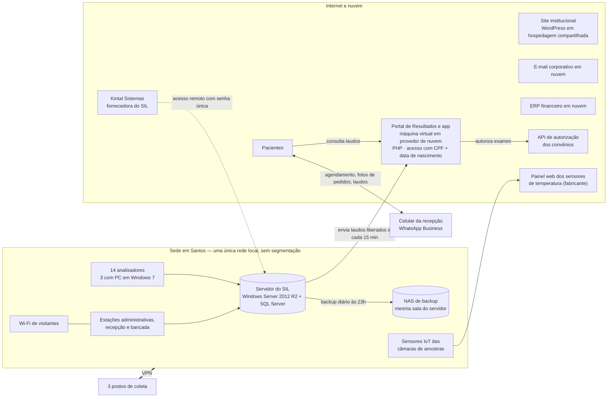

# 🏥 Cenário: Laboratório Maré Viva Análises Clínicas

> ⚠️ **Empresa fictícia**, criada só para esta atividade. Nomes, números, endereços e
> sistemas são inventados; qualquer semelhança com organizações reais é coincidência.
> **Não teste nenhum sistema real** — todo o trabalho é de análise, feito no papel e na
> planilha.

[⬅️ Voltar ao roteiro](../README.md) · [Ir para as evidências ➡️](evidencias.md)

---

## 1. A empresa

O **Laboratório Maré Viva** faz exames de sangue, urina e outros materiais biológicos
na Baixada Santista.

| Item | Situação |
|---|---|
| Unidades | Sede em **Santos** (área técnica, onde as amostras são processadas, e sala de servidores) e 3 **postos de coleta** (São Vicente, Guarujá e Praia Grande) |
| Funcionários | 120 (atendimento, coleta, bancada técnica, administrativo) |
| Movimento | cerca de **900 atendimentos por dia** |
| Pacientes cadastrados | cerca de **210 mil** (nome, CPF, data de nascimento, telefone, endereço, convênio e **histórico de exames e laudos**) |
| Clientes | pacientes particulares, 15 **convênios** (operadoras de planos de saúde) e **2 hospitais parceiros**, para os quais o laboratório faz exames de urgência 24 horas por dia |
| Receita | cerca de R$ 2,4 milhões por mês; o contrato com os hospitais responde por ~25% |
| Equipe de TI (tecnologia da informação) | **3 pessoas** (o coordenador Rafael Lima e 2 técnicos de suporte), das 8h às 18h; não há profissional dedicado à segurança da informação |
| Orçamento | **R$ 150 mil** aprovados para segurança da informação no próximo ano, além da equipe atual |

> 📌 **Por que isso importa?** Um laboratório trata **dados de saúde**, que a Lei Geral de
> Proteção de Dados Pessoais (LGPD) classifica como **dados pessoais sensíveis** (veja a
> revisão de conceitos no roteiro). Além disso, um **laudo** (documento com o resultado do
> exame) errado pode levar um médico a uma decisão errada sobre o paciente: aqui, falhas de
> **integridade** podem afetar a saúde de pessoas.

---

## 2. Termos técnicos usados no cenário

Leia esta tabela **antes** de olhar os sistemas: todos esses termos aparecem logo abaixo e nas
evidências.

| Termo | O que significa |
|---|---|
| **SIL** | **Sistema de Informação Laboratorial**: o sistema central do laboratório. Registra o paciente, os exames pedidos, recebe os resultados dos equipamentos e gera os laudos. Sem ele, o laboratório não funciona (em inglês, LIS) |
| **Analisador** | Equipamento automatizado que processa as amostras e envia os resultados ao SIL. Alguns vêm com um computador acoplado que os controla |
| **TI e RH** | Tecnologia da informação (a equipe que cuida dos computadores e sistemas) e recursos humanos (o setor que contrata e desliga funcionários) |
| **Sistema operacional (SO)** | Software básico que faz o computador funcionar (por exemplo, Windows). Quando o fabricante encerra o **suporte**, deixa de publicar **correções de segurança**: falhas descobertas depois disso ficam abertas para sempre |
| **Servidor** | Computador que fica ligado o tempo todo oferecendo um serviço a outros computadores (aqui, o SIL e seu banco de dados) |
| **Banco de dados** | Software que guarda e organiza as informações de um sistema (o SIL usa o SQL Server, da Microsoft) |
| **Ferramenta de acesso remoto** | Programa que permite controlar um computador à distância, pela internet, como se a pessoa estivesse na frente dele |
| **HD externo** | Disco rígido portátil, ligado ao computador por cabo USB |
| **Backup** | Cópia de segurança dos dados, para recuperá-los se o original for perdido ou danificado |
| **Criptografia (cifrar)** | Embaralhar os dados com uma chave, de forma que só quem tem a chave consiga lê-los |
| **Nobreak** | Equipamento com bateria que mantém os computadores ligados por alguns minutos quando falta energia |
| **Hospedagem compartilhada** | Serviço barato em que vários sites de clientes diferentes rodam no mesmo servidor do provedor |
| **Endereço IP, faixa de endereços e porta** | Endereço IP é o "número" de cada equipamento na rede; uma faixa de endereços é um bloco desses números (equipamentos na mesma faixa conversam entre si). Porta é o número que identifica um serviço dentro do equipamento (por exemplo, a 22 é a do SSH) |
| **HTTP e HTTPS** | Protocolos de acesso a páginas web. O HTTP envia tudo sem criptografia; o HTTPS usa TLS (veja abaixo) |
| **Credenciais** | Dados que comprovam a identidade de um usuário ou sistema: usuário e senha, chave de API, certificado |
| **Arquivo de configuração** | Arquivo do sistema com parâmetros de funcionamento, como endereços e senhas de acesso ao banco de dados |
| **Boletim de segurança** | Aviso publicado pelo fabricante que descreve falhas e as correções (atualizações) que as resolvem. A Microsoft identifica os antigos com códigos como MS17-010 |
| **NAS** | *Network Attached Storage*: caixa com discos ligada à rede, usada para guardar arquivos e cópias de segurança (backup). Quando aparece como **unidade de rede** num computador, esse computador consegue ler **e apagar** o que está nela |
| **Rede local e segmentação** | Rede local é a rede interna da sede. **Segmentar** é dividir essa rede em partes isoladas (por exemplo, com VLANs, redes virtuais configuradas nos equipamentos de rede), para que um problema numa parte não alcance as outras |
| **VPN** | Rede privada virtual: um "túnel" cifrado pela internet. Aqui, liga os postos de coleta à sede |
| **MFA** | Autenticação multifator: além da senha, exige um segundo fator, como um código no celular. Se a senha vazar, o invasor ainda trava no segundo fator |
| **Nuvem e máquina virtual** | Nuvem: servidores de uma empresa externa (o **provedor**), alugados pela internet. Máquina virtual: um "computador" simulado dentro desses servidores, alugado por mês |
| **ERP** | Sistema de gestão empresarial (do inglês *Enterprise Resource Planning*): financeiro, contas a pagar, faturamento dos convênios |
| **API e chave de API** | API (interface de programação) é a "porta" pela qual um sistema conversa com outro. A **chave de API** funciona como uma senha que identifica quem está usando essa porta |
| **PHP** | Linguagem de programação usada para construir sites e sistemas web, como o Portal de Resultados |
| **SSH** | Protocolo de acesso administrativo remoto a servidores (o OpenSSH é o programa mais usado para isso) |
| **TLS** | Protocolo que cifra a comunicação entre o navegador e o site (é o "S" do HTTPS). As versões 1.0 e 1.1 são antigas e consideradas inseguras |
| **WordPress e plugin** | WordPress é uma plataforma para criar sites. Plugins são complementos instalados nele (formulários, galerias…). Cada plugin é um software a mais que precisa de atualização |
| **IoT** | Internet das Coisas: equipamentos comuns (aqui, sensores de temperatura) ligados à internet |
| **SMB e SMBv1** | Protocolo do Windows para compartilhar arquivos e impressoras na rede. A versão 1 (SMBv1) é antiga e tem falhas graves conhecidas |
| **Log** | Registro automático de eventos de um sistema (quem entrou, quando, o que fez). Sem logs, não dá para investigar um incidente |
| **Antivírus** | Programa que detecta e remove programas maliciosos conhecidos nos computadores |
| **Phishing** | Golpe em que o criminoso se passa por alguém confiável (por e-mail, mensagem, site falso) para roubar senhas ou induzir a vítima a agir |
| **Ransomware** | Programa malicioso que cifra (embaralha) os dados e exige pagamento de resgate para liberá-los; muitas vezes também copia os dados e ameaça publicá-los |
| **Repositório público de código** | Local na internet (como o próprio GitHub) onde programadores guardam código-fonte. Se for público, **qualquer pessoa** pode ler — inclusive senhas esquecidas dentro do código |

---

## 3. Sistemas e infraestrutura

### 3.1 Visão geral

### 3.2 Descrição dos sistemas

| Sistema / recurso | Como funciona hoje |
|---|---|
| **SIL "LabCore"** | Fornecido pela **Kintal Sistemas** (empresa terceirizada). Roda num servidor físico na sede (`SRV-SIL01`), com Windows Server 2012 R2 e banco SQL Server. Recebe os resultados dos analisadores e gera os laudos. A Kintal faz manutenção por **ferramenta de acesso remoto** |
| **Analisadores** | 14 equipamentos ligados ao SIL. Três deles são controlados por computadores acoplados com **Windows 7**, que o fabricante não permite atualizar |
| **Portal de Resultados e app** | Pacientes consultam e baixam laudos em PDF. Desenvolvido por um programador autônomo (*freelancer*) cujo contrato terminou em 2024; desde então, ninguém altera o código. Roda numa máquina virtual em provedor de nuvem. Também consulta a **API dos convênios** para autorizar exames |
| **Site institucional** | WordPress em hospedagem compartilhada, com endereços, horários e formulário "Trabalhe conosco", que recebe e guarda cerca de 400 currículos por ano |
| **E-mail corporativo** | Serviço de e-mail em nuvem para os 120 funcionários |
| **ERP financeiro** | Serviço em nuvem: contas a pagar, faturamento dos convênios, boletos |
| **WhatsApp Business** | Um celular na recepção da sede, usado por 6 atendentes para agendamentos e dúvidas |
| **Backup** | Cópia diária do SIL para um NAS na mesma sala do servidor; cópia mensal manual em HD externo |
| **Rede** | Uma única rede local na sede para tudo (servidor, analisadores, estações, Wi-Fi de visitantes). Postos ligados por VPN |
| **Câmaras de amostras** | Geladeiras especiais que conservam as amostras. Sensores IoT enviam a temperatura para um painel web do fabricante, que dispara alarmes |
| **Sala de servidores** | Térreo da sede, a duas quadras de um dos canais de Santos. Um ar-condicionado, nobreak de ~20 minutos, sem gerador |
| **Estações de trabalho** | Cerca de 70 computadores Windows com antivírus tradicional. Quatro notebooks (TI e diretoria) |

### 3.3 Requisitos do negócio

- Resultados de **exames de urgência** para os hospitais parceiros: em até **2 horas**, 24 horas
  por dia. Atrasos geram multa contratual.
- Com o SIL parado, o laboratório opera em **contingência em papel por até 4 horas**. Depois
  disso, suspende coletas e remarca pacientes.
- Pacientes e médicos esperam **sigilo absoluto** sobre os exames.

---

## 4. Critérios de risco do Laboratório Maré Viva

Estes critérios foram **aprovados pela diretoria** e devem ser usados por todos os grupos.
São eles que tornam a análise **comparável**: dois grupos que olham o mesmo risco devem chegar a
notas parecidas, e a justificativa tem que citar qual descrição abaixo foi aplicada.

### 4.1 Probabilidade (P)

| P | Nível | Use quando… |
|:-:|---|---|
| **1** | Rara | Exige acesso privilegiado (conta de administrador) ou a áreas restritas, ou uma combinação pouco comum de condições; não há histórico no laboratório |
| **2** | Possível | Exige algo a mais: uma senha, o engano ou erro de alguém, estar na rede interna, ou um evento comum (furto, perda, falha de um serviço contratado) **ou** o ativo está exposto, mas um controle reduz parcialmente a chance **ou** já aconteceu no laboratório **há mais de 12 meses** |
| **3** | Provável | **Exposto** e explorável diretamente, sem controle (falha conhecida com exploração pública, senha de fábrica, credencial publicada) **ou** **já aconteceu no laboratório** nos últimos 12 meses |

> 📌 **Exposto** = alcançável pela internet. Algo que só se alcança de dentro da rede da sede
> "exige estar na rede interna" (P2, no máximo).
>
> 📌 **No risco residual**, avalie P **com o controle já implantado**: uma ocorrência anterior ao
> controle não impede que o residual fique em P1 ou P2.

### 4.2 Impacto (I)

Avalie as quatro dimensões e **use a mais alta**.

| I | Nível | Operação | Financeiro | Dados pessoais | Saúde e reputação |
|:-:|---|---|---|---|---|
| **1** | Baixo | Indisponibilidade < 1 h, sem atrasar urgências | < R$ 10 mil | Nenhum dado pessoal, ou poucos dados comuns sem exposição externa | Sem efeito para pacientes |
| **2** | Moderado | Indisponibilidade de 1 h a 4 h, **sem atrasar urgências** (a contingência em papel segura) | R$ 10 mil a R$ 100 mil | Dados pessoais comuns de até 1.000 pessoas **ou** dados de saúde de até 10 pacientes | Reclamação formal de paciente, convênio ou hospital |
| **3** | Alto | Indisponibilidade > 4 h **ou** atraso de exames de urgência | > R$ 100 mil | Dados pessoais comuns de mais de 1.000 pessoas **ou** dados de saúde de mais de 10 pacientes | Risco à saúde do paciente (laudo errado ou alterado); notícia na imprensa |

> 📌 Se o incidente precisaria ou não ser comunicado à autoridade de proteção de dados é uma
> análise à parte: ela **não** entra na nota de impacto.

### 4.3 Nível de risco e matriz

**Nível = P × I** (valores possíveis: 1, 2, 3, 4, 6, 9).

| P \ I | **1** Baixo | **2** Moderado | **3** Alto |
|:-:|:-:|:-:|:-:|
| **3** Provável | 3 🟨 Médio | 6 🟥 Alto | 9 🟥 Alto |
| **2** Possível | 2 🟩 Baixo | 4 🟨 Médio | 6 🟥 Alto |
| **1** Rara | 1 🟩 Baixo | 2 🟩 Baixo | 3 🟨 Médio |

### 4.4 Critérios de aceitação (apetite a risco)

| Classificação | Nível | O que a Maré Viva exige |
|---|:-:|---|
| 🟩 **Baixo** | 1–2 | Pode ser **aceito** pelo coordenador de TI. Revisar uma vez por ano |
| 🟨 **Médio** | 3–4 | **Tratar em até 180 dias** **ou** aceitar formalmente, com justificativa escrita assinada pela diretora-geral |
| 🟥 **Alto** | 6–9 | **Não pode ser aceito.** Plano de tratamento iniciado em até 30 dias |

**Meta para o risco residual:** depois do tratamento, todo risco deve ficar com **nível ≤ 4**.
Se não for possível, explique por quê na coluna **Justificativa do residual** da planilha.

---

## 5. Pessoas entrevistadas

| Pessoa | Cargo | Evidência |
|---|---|---|
| Dra. Helena Prado | Diretora-geral e responsável técnica do laboratório | [E1](evidencias.md#e1--entrevista-com-a-dra-helena-prado-diretora-geral) |
| Rafael Lima | Coordenador de TI | [E2](evidencias.md#e2--entrevista-com-rafael-lima-coordenador-de-ti) |
| Juliana Costa | Supervisora de atendimento | [E3](evidencias.md#e3--entrevista-com-juliana-costa-supervisora-de-atendimento) |

Os demais documentos (varredura de vulnerabilidades, registro de ocorrências e mensagens
recebidas) estão em [evidencias.md](evidencias.md).

[⬅️ Voltar ao roteiro](../README.md) · [Ir para as evidências ➡️](evidencias.md)
